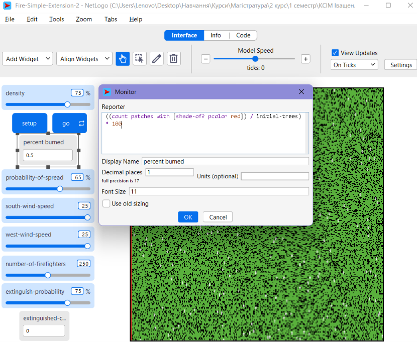
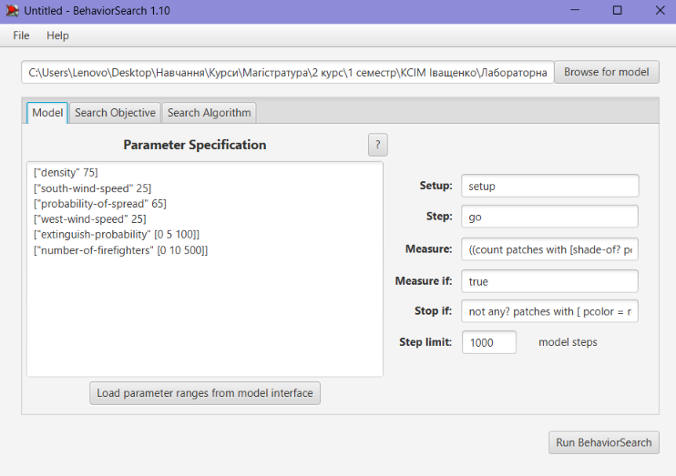
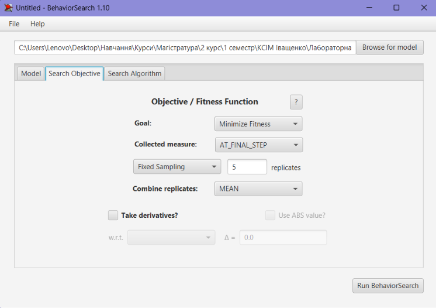
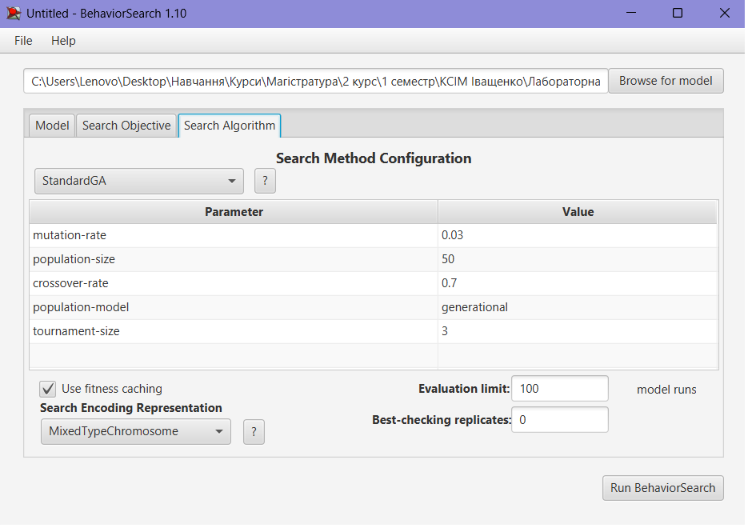
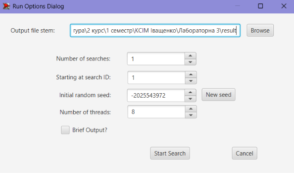
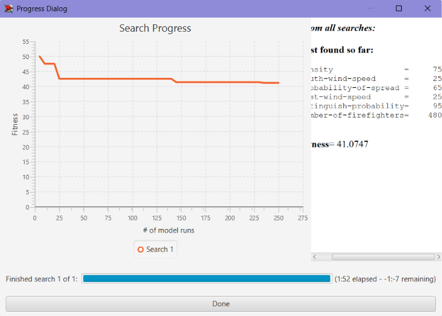
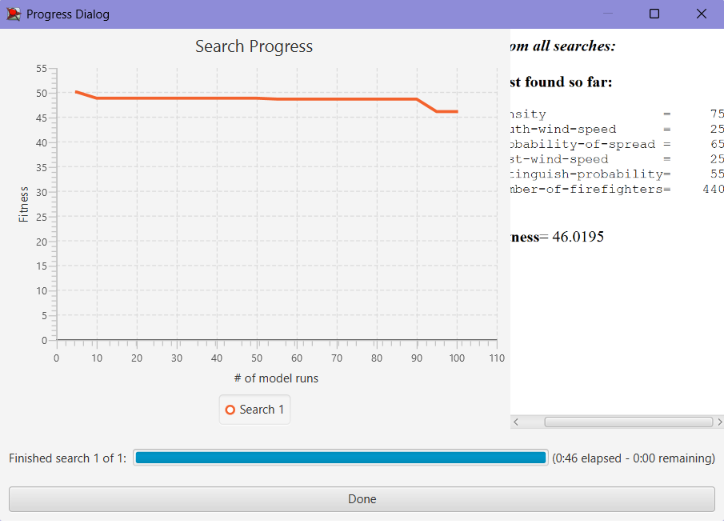

## Комп'ютерні системи імітаційного моделювання
## СПм-25-1, **Ткаченко Тетяна Андріївна**
### Лабораторна робота №**3**. Використання засобів обчислювального интелекту для оптимізації імітаційних моделей

 

### Варіант 5, модель у середовищі NetLogo:
[Fire Simple Extension 2](https://www.netlogoweb.org/launch#http://www.netlogoweb.org/assets/modelslib/IABM%20Textbook/chapter%203/Fire%20Extensions/Fire%20Simple%20Extension%202.nlogo)

 

#### Вербальний опис моделі:
Модель імітує поширення лісової пожежі. Поле складається з ділянок, зелені ділянки це дерева, чорні це порожні місця. На початку симуляції підпалюється лівий стовпчик поля. На кожному такті палаюча ділянка з певною ймовірністю підпалює сусідні дерева по чотирьох напрямках, а вітер збільшує цю ймовірність в одному напрямку і зменшує в протилежному. Ділянка, що згоріла, темніє. У модифікованій версії з другої лабораторної роботи на полі також діють пожежники. Вони випадково переміщуються по ділянках, що ще не згоріли, і гасять сусідні палаючі ділянки з певною ймовірністю. Модель показує, як площа згорілого лісу залежить від щільності дерев, вітру та зусиль із гасіння пожежі.

#### Керуючі параметри:
- **density** визначає щільність дерев у лісі, тобто частку території, зайняту деревами.
- **probability-of-spread** визначає ймовірність поширення вогню від одного дерева до сусіднього.
- **south-wind-speed** визначає силу та напрямок вітру вздовж осі північ–південь. Додатне значення відповідає південному вітру, а від’ємне північному.
- **west-wind-speed** визначає силу та напрямок вітру вздовж осі схід–захід. Додатне значення відповідає західному вітру, а від’ємне східному.
- **number-of-firefighters** визначає кількість агентів у середовищі моделювання, тобто, в даній моделі, кількість пожежників на полі.
- **extinguish-probability** визначає ймовірність того, що пожежник загасить сусідню палаючу ділянку за один такт симуляції.

#### Показники роботи модеі:
- відсоток згорілого лісу, тобто частка дерев, що згоріли, від початкової кількості дерев.
- кількість загашених ділянок, тобто скільки палаючих ділянок загасили пожежники.
- кількість тактів симуляції, що минули з початку роботи моделі.

 

### Налаштування середовища BehaviorSearch:

**Обрана модель**:
<pre>
C:\Users\Lenovo\Desktop\Навчання\Курси\Магістратура\2 курс\1 семестр\КСІМ Іващенко\Лабораторна 2\Fire-Simple-Extension-2.nlogox
</pre>

Фінальний код моделі та її інтерфейс доступні за [посиланням](Fire-Simple-Extension-2.nlogox)

**Параметри моделі** (вкладка Model):  
Параметри та їх можливі діапазони були вилучені середовищем BehaviorSearch із інтерфейсу моделі за допомогою кнопки завантаження діапазонів, а потім скориговані вручну. Чотири параметри, що описують умови пожежі, залишилися незмінними, їх значення взято з експерименту другої лабораторної роботи. Два параметри, якими можна керувати, змінюються під час пошуку, це ймовірність гасіння та кількість пожежників.
<pre>
["density" 75]
["south-wind-speed" 25]
["probability-of-spread" 65]
["west-wind-speed" 25]
["extinguish-probability" [0 5 100]]
["number-of-firefighters" [0 10 500]]
</pre>

**Використовувана міра**  
Для фітнес-функції було обрано відсоток згорілого лісу. Вираз для його розрахунку взято з налаштувань монітора percent burned у вихідній моделі та вказано в параметрі "Measure".
<pre>
((count patches with [shade-of? pcolor red]) / initial-trees) * 100
</pre>

Значення береться після завершення пожежі, тобто на останньому такті симуляції. Параметр "Measure if" має значення true, тобто враховуються всі такти симуляції. Параметр зупинки "Stop if" має значення:
<pre>
not any? patches with [ pcolor = red ]
</pre>
Тобто симуляція зупиняється, коли в лісі не лишилося палаючих ділянок. Параметр "Step limit" дорівнює 1000 тактів.

Загальний вигляд вкладки налаштувань параметрів моделі:

**Налаштування цільової функції** (вкладка Search Objective):  
Метою підбору параметрів моделі є мінімізація відсотка згорілого лісу, це вказано через параметр "Goal" зі значенням Minimize Fitness. Тобто необхідно визначити такі значення ймовірності гасіння та кількості пожежників, при яких згорає найменше лісу. У параметрі "Collected measure" вказано AT_FINAL_STEP, тобто береться значення показника на останньому такті, коли пожежа вже закінчилась. Таке значення обрано, тому що відсоток згорілого лісу під час пожежі лише зростає, і потрібен його підсумок. Щоб уникнути впливу випадковості, кожна симуляція повторюється по 5 разів, результуюче значення розраховується як середнє арифметичне.
Загальний вигляд вкладки налаштувань цільової функції:  

**Налаштування алгоритму пошуку** (вкладка Search Algorithm): 
Використовуються два алгоритми, випадковий пошук (RandomSearch) і простий генетичний алгоритм (StandardGA). Спосіб кодування "Search Space Encoding Representation" має значення MixedTypeChromosome. Параметр "Use fitness caching" увімкнено.
Загальний вигляд вкладки налаштувань алгоритму пошуку:  

 

### Результати використання BehaviorSearch:
Діалогове вікно запуску пошуку:  

 

Результат пошуку параметрів імітаційної моделі, використовуючи **генетичний алгоритм**:  

 

Результат пошуку параметрів імітаційної моделі, використовуючи **випадковий пошук**:  

## Висновки
У ході виконання лабораторної роботи було вивчено, як у середовищі BehaviorSearch налаштовується оптимізація параметрів імітаційної моделі, тобто вибираються керуючі параметри, їх діапазони та цільова функція. Було вивчено використання випадкового пошуку та простого генетичного алгоритму для підбору значень параметрів. Було вивчено порівняння результатів двох алгоритмів і перевірку знайдених значень у середовищі NetLogo.
